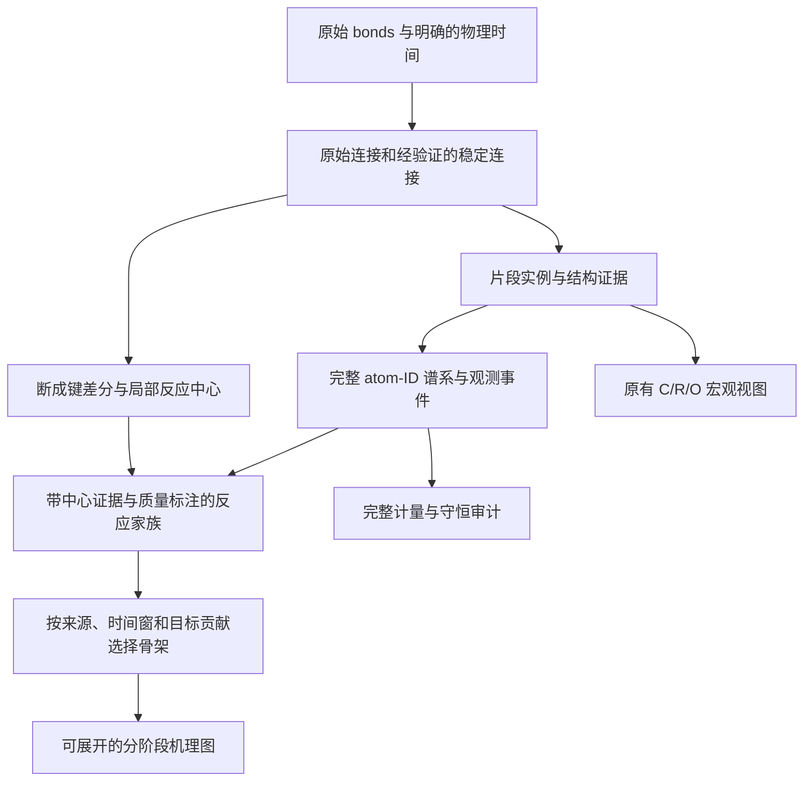

**基于 Xiao（2024）与 Yang（2024）的反应网络改进分析**

阅读与只读核查日期：2026-10-15。本文区分论文中的方法、现有实现的观测结果和针对本项目的设计建议；尚未实现所建议的算法，也未修改生产数据库。

当前系统已具备原子谱系、完整计量、守恒审计、断点恢复和低内存执行基础。优先需要补齐的是反应中心证据、适当的化学分辨率，以及考虑时间和局部贡献的骨架选择。建议保留 C/R/O 作为宏观类别视图，在实例证据层增加结构身份与反应中心信息，再从同一证据构建可展开的机理骨架。

**1. 阅读来源与定位**

| 论文 | 方法名与出版信息 | 本次重点核对位置 |
|---|---|---|
| Xiao, Y.; Zheng, M.; Li, X.; Ren, C. *Automated Skeleton Network Generation for ReaxFF Molecular Dynamics Simulations of Hydrocarbon Fuel Pyrolysis and Oxidation via a Rate-Based Algorithm* | RxMD-SN；JCTC 2024, 20, 5539–5557；[DOI](https://doi.org/10.1021/acs.jctc.4c00409) | PDF 第 3–5 页，方法 2.1–2.2、图 1–3、式 1–3；第 6、8–9 页验证；第 14–17 页应用与结论 |
| Yang, S.; Li, X.; Zheng, M.; Ren, C.; Guo, L. *Generating a skeleton reaction network for reactions of large-scale ReaxFF MD pyrolysis simulations based on a machine learning predicted reaction class* | SRG-Reax；PCCP 2024, 26, 5649–5668；[DOI](https://doi.org/10.1039/D3CP05935A) | PDF 第 3–8 页，方法 2.1、表 1–2；第 8–10 页，方法 2.2、图 6–7；第 12–19 页应用、边界与结论 |

全文来源为用户提供的两个本地 PDF，共 19 页和 20 页；在线检索核对了出版信息与摘要。出版社全文页面直接访问返回 403，本次方法、公式和图示的核查使用本地全文。补充材料未单独完整读取，因而本文不声称复现了 46 类的完整定义、训练数据或模型代码。

本地原文：[Xiao 全文](</home/dmin/CoarseRL2Mol/reax network/Xiao 等 - 2024 - Automated Skeleton Network Generation for ReaxFF M.pdf>)；[Yang 全文](</home/dmin/CoarseRL2Mol/reax network/Yang 等 - 2024 - Generating a skeleton reaction network for reactio.pdf>)。

**2. Xiao：利用动态反应贡献选择骨架**

RxMD-SN 的输入包括详细物种身份、各物种随时间的浓度、详细反应及其发生次数。图 1 的上游包含连接片段识别、键类型识别，以及通过 InChI 或 SMILES 建立全局物种索引。这个物种身份层比本项目的 C/R/O 类别更细。

方法 2.1 在独立事件和短时间窗内浓度近似不变的假设下，使用 Poisson 计数和最大似然估计反应速率常数。按原文符号，式 2 可写为：

\[
\widehat{k_i}=\frac{\sum_m\lambda_{i,m}}{V\Delta\mathrm{frame}\sum_m\prod_j c_j(t_m)^{\nu'_{ij}}}.
\]

这是“发生次数除以反应物暴露量”的思路。实现时必须先统一浓度、体积和时间的定义；使用摩尔浓度时还需要正确进行事件数与物质的量换算。有限粒子体系中相同反应物的组合数也应明确处理，不能把这个公式直接套到任意类别事件上。

式 3 用正、逆反应贡献之差的绝对值计算净反应速率大小：

\[
w_i(t)=\left|k_i^+\prod_jc_j(t)^{\nu'_{ij}}-k_i^-\prod_jc_j(t)^{\nu''_{ij}}\right|.
\]

方法 2.2 构建“时间 × 反应”的动态矩阵，从原始燃料组成的 core species set 出发，结合 BFS 遍历和各时间窗 Top-N 速率排名，逐步加入相关产物与通道，再整合不同时间的网络。价值在于保留仅在某一阶段占主导的反应，它们在全程累计排名中可能很低。

原文采用 0.02 ps 的轨迹输出间隔，以 20 个间隔组成 0.4 ps 的统计窗。这些是其研究条件下的选择。本项目必须先确定自己的时间标定和采样敏感性，不能照搬这两个数值。

验证既包括从完整反应集合构建动力学模型后与 MD 浓度曲线比较，也包括改变骨架选择规模后的曲线比较。甲烷氧化示例将 7707 条反应、1608 种物种约简为 161 条反应、40 种物种，Top-N 为 55。该数字是示例的结果，并非本项目的目标规模。

适用边界也很重要：论文说明低贡献通道被删后网络可能不完全连通；甲烷与 GRI-Mech 共有的 55 个反应中，约 59% 的速率常数偏差小于一个数量级，约 31% 在 1–1.8 个数量级。MD 内部重现、与外部机理比较、推广到煤的含氧反应，是不同层面的验证。

**3. Yang：按照反应中心合并路径**

SRG-Reax 直接针对燃料混合物中结构多样、单条路径贡献分散的问题。反应类别依据断键、成键及其局部化学环境定义，包括反应中心、扩展反应中心和完整反应特征。其 46 类来自烃类燃料热解；本项目的 fragmentation、fusion、many_to_many 等描述的是参与片段数，处于另一种分类维度。

论文的 tri-training 模型由三个随机森林分类器组成，分别采用：

- 196 个分层反应特征，覆盖断成键、反应原子、邻域／官能团和整体反应；
- 完整反应的 1024 位 Morgan2 指纹差；
- 扩展反应中心的 512 位 Morgan2 指纹差与 18 个反应特征。

训练使用 7862 条标注反应、9386 条未标注反应，标注样本按 70%／30% 划分训练与测试，并通过主动学习补充人工标注。表 2 报告主动学习后 Micro-F1 为 0.989、Macro-F1 为 0.927。小样本类别仍有不足；这些指标不证明模型可直接迁移到煤的含氧化学。

方法 2.2 与图 7 从指定燃料或中间体集合出发，搜索其反应子网络，按反应类别合并路径，统计 reaction class ratio 和 product species ratio，再沿中间体继续 BFS。原文按反应路径数和产物数量定义比例，这些比例不能自动解释为速率常数，也不能不说明分母就换成碳贡献或事件概率。

原文在每轮搜索之间保留人工约简，因为统一截断阈值难以处理复杂混合物。图 6 的反例很直接：只保留高频路径的前 5%，虽然网络变小，却损失了许多环烷烃、芳烃来源的路径。因此，“自动分类与合并”和“完全自动得到有效骨架”必须分开评估。

论文允许相似局部结构的多个中间体组成一个节点集合，这对大分子尤其有参考价值。其 1 ps 分析间隔下也明确报告了同一观测反应包含多个反应类别的情况，并没有把全部跨帧变化都当成单一步骤。

**4. 当前实现与真实结果中的具体差距**

以下计数来自现有导出的 raw `reaction_channels.csv`：排除了 persistence，未应用 UI 的类别、时间、活动类型等筛选。

| 检查项 | 观测值 | 含义 |
|---|---|---|
| 非持续事件／通道 | 88,189／5,575 | 是观测事件和类别计量通道的规模 |
| 只发生一次的通道 | 3,567，占通道数 63.98% | 有大量低统计支持通道；不能据此把它们全部判成噪声 |
| 两侧类别计量相同的活动 | 239 条通道、27,347 次事件，占事件数 31.01% | 需要局部化学证据才能解释其化学意义 |
| 按累计次数取前 12 条 | 占全部非持续事件 37.61% | 仅是全量 raw 范围的基准；不同 UI 筛选的分母会改变 |
| 最高频通道 | 最大区间类别的类内重排，8013 次 | 排名会强调宽类别中的重复活动，难以直接说明主导化学过程 |

对目录中三个真实 bonds 样本重新解析得到：

| 样本 | 最大质量类别 | 该类别质量占比 |
|---|---|---|
| bond0 | C40+_R10+_O3+ | 100% |
| bond3512 | C40+_R10+_O3+ | 49.27% |
| bond19998 | C40+_R10+_O3+ | 78.15% |

这些占比只对应三个样本，不能直接称为全轨迹统计或焦炭产率。它们说明需要检查上界类别饱和：即使大分子的实际 C、R、O 数变化很大，显示仍可能落在同一个区间。

bond3512 的 `C1-5_R0_O0` 实际包含 CH4、CH3、C2H6、C2H4、C2H3、C2H2 等多种元素组成。当前分类用于宏观组成是有意义的；解释甲烷生成、自由基终止、脱氢过程时，必须允许展开这些差异。

对应到实现，有七个具体问题需要处理：

1. `pseudo_species.py` 很早就把实例归入 C/R/O；`fragment_lineage.py` 和 `network_postprocess.py` 以完整类别计量式聚合通道。不同反应中心因此可能汇入同一个签名。元素组成相同的异构体也不能仅靠分子式区分。
2. `reaxff_fragments.py` 的 topology_hash 包含原子 ID 及阈值化连接。它适合比较同一批原子的连接是否变化，不能充当不同 atom ID 分子之间的结构等价主键；也不能从哈希反推出断了哪条键。
3. `trajectory_pipeline.py` 保存片段原子集、组成和哈希，没有保存完整逐原子连接、逐原子 abo、nlp、q。仅重聚合现有哈希无法恢复反应中心。
4. `fragment_lineage.py` 把相邻帧谱系连通分量作为一个事件。大分子多个位点在同一采样间隔内的改变可能合并成一个观测事件。原子全守恒也不能证明该变化属于单个基元步骤。
5. `confidence` 主要由原子守恒与重叠构造；闭合体系中这些指标可能很高。它不是经校准的“反应真实概率”，也不能区分键振动与稳定化学转化。
6. 当前 `temporal_profile` 为 off。已有驻留与逆转标注值得保留，但仅启用 exclude 不一定解决问题：默认会保留守恒的 fast_intermediate_candidate。需要针对连接证据评估稳定性，而不是统一删除短寿命物种。
7. 主网络查询支持按一个选定窗口重新统计，但尚无按多个时间窗、来源集合和反应家族自动选择并整合骨架的算法。路径阶段摘要采用均匀帧边界，也不是反应阶段自动识别。

还有一项真实时间问题：只读查询 frames 表发现内部帧 2000 和 2001 的 header timestep 同为 200000，其余相邻步差为 100。当前按文件名排序允许这种情况，用于顺序浏览不一定有错；估计速率时需要先核查它是 restart 时间重复、重复快照还是其他原因。数据库也未给出 timestep 到物理时间的完整换算。不能直接除以零时间差，或把内部 frame_id 当 ps。

当前完整性范围是输入 manifest；既有运行未验证文件编号缺口。这应作为数据诊断项，不能把未验证的完整性当成已证实。

**5. 建议的总体结构**

保留实例、事件和计量主键，给新增证据及骨架生成配置独立版本。折叠、分类和骨架选择是派生操作，每个显示过程都应能展开到原事件、参与片段、原子与连接变化。

**6. 先补反应中心与多分辨率证据**

逐相邻帧读取连接集合，对原事件涉及的原子计算：

\[
\Delta E^- = E_t\setminus E_{t+1},\qquad
\Delta E^+ = E_{t+1}\setminus E_t.
\]

保存原始断成键、元素类型、键级前后值、涉及原子与可配置邻域的前后环境。将原始差分与稳定连接差分分别存储，避免去噪结果覆盖观测证据。第一轮只分析高频通道和有代表性的单次通道，也能快速检验价值。

分类起步采用可审查规则和未知类别：C–C／C–H／C–O 断裂、成键、氢转移、环连接变化等。区分 β-裂解、特定官能团脱除或芳香反应需要更完整的自由基、键型与局部环境证据；不能仅由片段数或总环数变化确定。允许一条观测事件包含多个中心／多个标签，并保留无法确定的复合过程。

多中心事件只能在证据足以证明相互独立时拆成子事件。多个反应中心共用一个原片段时，不能把该大分子的完整质量和计量在多个子事件中重复计算。原始观测事件仍是完整计量和守恒审计的单位，中心标签作为其内部证据。

在类别视图之外增加可选的结构证据视图：对常见小分子显示具体身份；对大分子显示局部结构、官能团候选和区间内分布。C/R/O 类别本身可保持现有定义；若增加区间或产生细分配置，应保存版本及映射，避免与旧 P 编号混用。化学键型、自由基和芳香性识别需要独立校验，不能从 E−V+1 推断芳香性。

**7. 去噪与事件质量要独立验证**

候选方案包括连接滞回、连接保持时间和基于同一 atom-ID 连接状态的时间滤波。它们是本项目的设计建议，不是两篇论文已为本项目验证的结论。

滞回阈值必须受输入文件保存的 BO cutoff 约束。若原文件只输出 BO≥0.3 的连接，就不能假装观测到了 0.3 以下的键级；低阈值方案需要更完整的原始输出，或明确的不确定状态。

同时保留短寿命稳定连接的真实中间体。正、逆次数接近也不证明噪声：高频融合／裂解可能是真实交换或平衡，需要同一实例的连接序列作证据。参数选择应比较重采样、不同 cutoff／保持时长下的事件与产物保留情况。

质量字段分开记录输入连续性、原子／元素守恒、连接可观测性、稳定性、反应中心可分解性和重复统计支持。没有监督校准前，输出证据等级或特征，不把启发式分数解释成概率。将“原子账目完整”与“基元反应已识别”分开。

**8. 结合两篇论文构建骨架选择**

为每个来源集合、时间窗、反应家族建立统计，而不是仅保留全程累计高频通道。来源集合可以是指定初始片段、某个类别的片段，或有明确结构证据的一组中间体。

先做不依赖速率常数的版本：在时间标定正确时统计窗口事件强度 N/Δt，以及碳／氧／质量的累计转移强度；同时报告反应物参与量和统计支持。它们是观测强度，不是基元反应速率常数。同一原子可在多个事件中累计转移，不能当作最终产率。

对每个来源集合报告反应家族的局部贡献、具体产物的数量贡献，以及目标产物的原子来源。必须明确按“不同路径数”“事件发生次数”还是“参与片段数”加权；完整系数大于 1 时也要说明是否按参与实例加权。多标签事件如报告命中率，总和可能大于 100%；若需要总和为 100% 的分支比例，就定义互斥主类、复合类或明确分摊权重。

每个窗口、每个来源分支保留一定的局部贡献覆盖，再把不同窗口的结果取并集；对来源和目标有证据连接的低频桥接事件单独保留。输出每条通道的入选理由：阶段主导、来源主分支、目标贡献、连接证据、人工保护等。窗口大小和覆盖目标通过验证选择，不预设为已证明有效的常数。

BFS 在这里用于组织候选与层级，不能凭类别相同就把不同时刻的不同实例串成路径。双分子／多分子反应保留完整超边，物质流投影的图论路径也不能替代计量可达性。验证源到目标的路径时，继续使用现有固定 atom-ID 集合和时间顺序证据。

路径权重按任务选择：碳主链追踪使用锚点碳原子数，脱氧过程可使用氧原子数，完整谱系仍保留所有元素。这样避免总原子数中的氢主导碳骨架路径，同时仍保留氢转移反应本身的证据。

反应阶段第一轮可使用固定物理时间窗，随后再尝试根据类别组成变化、连接变化或反应家族活跃度寻找阶段边界。摘要过程块继续明确保留“多事件过程”的语义与展开入口。

**9. 速率与机器学习作为后续工作**

RxMD-SN 的速率估计应放在时间、物种身份和事件质量验证之后。需要物理时间、体积／浓度、条件标签、足够的观测事件和反应物暴露量；对升温或变体积过程应分条件处理。对有充分依据的一／二分子反应估计 k 与计数不确定性，并检查模型是否重现独立时间段或独立轨迹的浓度曲线。

把众多不同结构直接混成一个 C/R/O 类别后，平均行为可能依赖该类别内部组成和历史；因此不能预设存在一个稳定、可迁移的质量作用定律速率常数。对于难以满足这些条件的大分子过程，先输出观测事件强度与条件分支比例。

借鉴 Yang 的反应中心表示和主动学习流程很有价值，但应先建立煤热解的标注准则和代表性事件集，尤其补充 C–O、含氧官能团与复合过程。训练时按轨迹、时间段或反应模板划分评估集合，避免同类重复事件同时进入训练和测试。报告 Macro-F1、各类 precision／recall 和未知类拒识表现，不能只追求总体准确率。新增模型依赖与计算成本应单独评估。

**10. 实施顺序、复用范围与验收**

| 阶段 | 交付内容 | 数据来源 | 核心验收 |
|---|---|---|---|
| P0：时间和分辨率诊断 | 核查重复 timestep、建立物理时间配置；统计区间饱和、低频与正逆活动 | 现有数据库、导出和模拟配置 | 时间异常逐项解释；全部统计有清楚分母 |
| P1：事件证据 | 断成键差分、局部环境、复合事件标注；原始／稳定连接对照 | 需要重新读取相关原始 bonds | 代表性事件人工核对；不重复计量；守恒与原子谱系完整 |
| P2：反应家族与动态骨架 | 规则分类、局部分支比例、分时选择、源到目标证据 | 新增证据及现有实例数据 | 阶段重要反应和来源分支保留；低频桥接可回溯；可展开到原事件 |
| P3：增强机理建模 | 受监督分类、适用子集的 k 与不确定性、可选结构细分 | 标注集、模拟条件和更细结构证据 | 独立样本分类表现；动力学曲线重现；参数敏感性与适用域检查 |

现有 v3 数据可直接用于分时计数、原子谱系、组成诊断和基于元素组成的小分子候选查询。反应中心和可靠结构身份需要重读原始连接，单纯运行旧的通道聚合无法补出缺失证据。当前首个原始输入路径仍可读取；尚未验证完整原始清单是否全部可用。

第一轮使用独立派生数据库或输出目录，记录输入与算法版本，保留当前生产结果用于比较。逐帧或逐帧对处理，采用压缩连接／变化记录和磁盘聚合，延续现有低内存设计。

科学验收比较原子与元素守恒、目标产物组成、源到目标的时间谱系、代表性反应中心、各来源／阶段／反应家族的保留情况，以及去噪和采样参数敏感性。有动力学模型时再比较浓度曲线误差和统计不确定性。图中节点少、布局清楚和事件覆盖率高，各自都只能证明其对应指标，不能单独证明骨架机理正确。

本次工作只完成论文分析和只读诊断。PDF 阅读依赖安装在 `/tmp/coal-paper-reader`，提取文本、核对用页面图和诊断 JSON 位于 `/tmp/coal-paper-reading`；这些临时文件不属于项目运行依赖。
